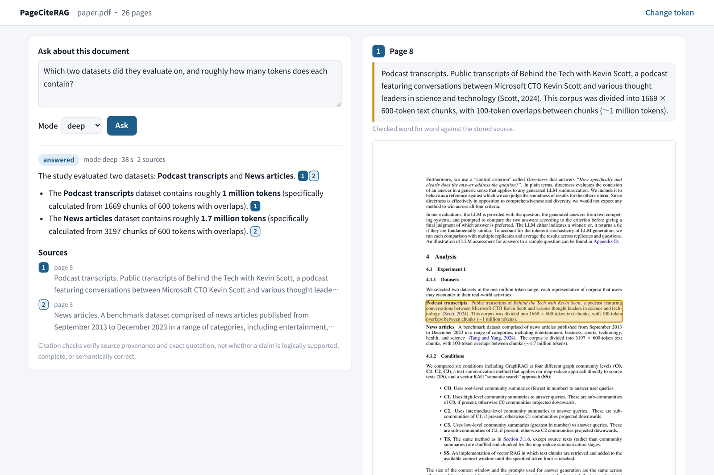

# PageCiteRAG

Ask questions about a paper on your own computer, in English or Chinese. Every answer quotes the
original text, checked word for word by the program, with the page it came from.



*The browser reader (`serve --pdf`), answering a question about the GraphRAG paper
([arXiv 2404.16130](https://arxiv.org/abs/2404.16130), CC BY 4.0). Clicking a source number shows
the PDF page with the quoted passage highlighted.*

## Highlights

- **Answers you can check**: the model first copies the passages it will use; the program keeps
  only quotations that match the stored source exactly. Each source marker in the answer shows the
  page and the exact quoted text (TXT and Markdown sources also give line numbers).
- **A free local 9B model matches GPT-4o-mini reading the whole document**: on 300 fresh
  questions, 77% correct versus 79% (no significant difference), with fewer wrong answers
  (5.7% versus 9.3%). When it answers, it is right 93% of the time, on par with GPT-6.1 Terra
  reading the whole document (92%).
- **One model call per question**: on 200 QASPER paper questions with the same local 9B model,
  accuracy is on par with PaperQA2 (0.58 versus 0.555) with fewer wrong answers (27.5% versus
  34%), using 1 model call per question where PaperQA2 uses a median of 11–12.
- **An agent for multi-step questions**: a LangChain evidence agent searches step by step. On
  200 fresh MuSiQue questions it answers 8.5 points more than fixed retrieval; against a generic
  ReAct agent with the same model and call budget, its wrong-answer rate is 5% versus 16%.
- **Says so when the evidence is missing**: with the same 9B model, 5.7% of answers are wrong,
  versus 11.7% when the model reads the document directly.
- **Runs entirely on your machine**: by default Qwen3.5-9B runs on your own GPU and documents
  never leave it. You can also use your own Ollama server or a free API.

## Example

On the paper
[From Local to Global: A GraphRAG Approach to Query-Focused Summarization](https://arxiv.org/abs/2404.16130)
(Edge et al., 2024, CC BY 4.0), with `deep` mode and Qwen3.5-9B on one GPU (39 seconds):

```bash
page-cite-rag ask DOCUMENT_ID "Which two datasets did they evaluate on, and roughly how many tokens does each contain?" \
  --mode deep --native-gpu --device cuda --gpu-uuid GPU_UUID
```

> The study evaluated two datasets: **Podcast transcripts** and **News articles**. [1][2]
> - The **Podcast transcripts** dataset contains roughly **1 million tokens** (specifically calculated from 1669 chunks of 600 tokens with overlaps). [1]
> - The **News articles** dataset contains roughly **1.7 million tokens** (specifically calculated from 3197 chunks of 600 tokens with overlaps). [2]

| Source | Page | Quotation, checked word for word against the PDF |
| --- | --- | --- |
| [1] | 8 | "Podcast transcripts. … This corpus was divided into 1669 × 600-token text chunks, with 100-token overlaps between chunks (∼1 million tokens)." |
| [2] | 8 | "News articles. … The corpus is divided into 3197 × 600-token text chunks, with 100-token overlaps between chunks (∼1.7 million tokens)." |

The agent needed 2 model calls and 1 search. The answer is shown exactly as produced; the
quotations are shortened here with "…".

On the same paper, "這篇論文的主旨是什麼？" ("What is the main idea of this paper?") is answered in
Traditional Chinese by the coverage agent in about 60 seconds (8 model calls, 7 searches).

## Results

### Compared with reading the whole document (300 fresh questions)

Questions come from LongBench Qasper, QASA, MultiFieldQA-zh, Chinese questions about English
papers, and LooGLE long-dependency QA. "Fresh" means the questions were first read after the design
was frozen. All answers are graded by the same judge.

| Approach | Correct | Wrong | Checkable sources |
| --- | --- | --- | --- |
| **PageCiteRAG + Qwen3.5-9B** (local, free) | **77%** | **5.7%** | Yes (94% confirmed by the judge) |
| PageCiteRAG + Qwen3.5-27B | 78% | 8.3% | Yes |
| PageCiteRAG + Qwen3.5-4B | 70% | 10.7% | Yes |
| Qwen3.5-9B reading directly (cut to fit) | 80% | 11.7% | No |
| GPT-4o-mini reading the whole document | 79% | 9.3% | No |
| GPT-6.1 Terra reading the whole document | 85% | 7.0% | No |
| Question only, no document | 19–26% | | |

- 9B versus GPT-4o-mini: −2 points correct (95% interval −7 to +3) and −3.7 points wrong
  (interval −7.0 to −0.3).
- When a document is too long for the local model's context, retrieval answers 11 points more
  than cutting the document to fit (72% versus 61%).
- Given the same evidence, 27B and GPT-6.1 Terra both reach 78%: the remaining gap comes from the
  answer writer preferring "not found" over guessing, not from model size.

### Individual tasks

All rows below use the same local model (Qwen3.5-9B) and the same judge.

| Task | Dataset | PageCiteRAG | Comparison |
| --- | --- | --- | --- |
| Paper detail QA | QASPER (200) | 0.58 correct, 27.5% wrong, 1 model call | PaperQA2 0.555, 34% wrong, median 12 calls (with GPT-4o-mini for both: PaperQA2 0.62, ours 0.545) |
| Multi-step reasoning | MuSiQue (100) | 0.52, 14% wrong | ReAct 0.43; LlamaIndex 0.43 (its "answer Unanswerable" instruction removed), 25% wrong |
| Multi-step reasoning (fresh) | MuSiQue (200) | 0.46, 5% wrong | Fixed retrieval 0.375; ReAct 0.41, 16% wrong |
| Paper QA (fresh) | LongBench Qasper (116) | 0.82, 4% wrong | Paper pasted into the model 0.81, 6% wrong |
| | QASA (50) | 0.72 | Pasted 0.84 (we answer "not found" more often: 20% versus 6%) |
| Chinese (fresh) | Chinese questions on English papers (60) | 0.73 | Same questions in English 0.80 |
| | MultiFieldQA-zh (34) | 0.94 | Pasted 1.00 |
| Whole-document summary (fresh) | LooGLE papers (120) | Key-fact coverage 0.594, faithfulness 0.80 (re-scored after fixing the judge's reply parsing) | Detail mode 0.555 / 0.76; the earlier section-by-section summary was 0.13 less faithful and about twice as slow |
| Follow-up questions (fresh) | QuAC (121 turns) | 0.66, 17% wrong | Chat with the dialogue history 0.66, 28% wrong |
| Citations supporting the answer | All of the above | Paper QA 98%, Chinese 96%, follow-ups 97%, multi-step 84% | — |

On one RTX A6000, a detail question takes about 20 seconds including model loading, a
whole-document question on a long document about 75 seconds, and the agent about 2 minutes.

## Modes

Choose with `--mode`; the default is `auto`.

| Mode | Good for | How it works |
| --- | --- | --- |
| `auto` | When unsure | Decides whether the question is about a detail or the whole document, then uses one of the two modes below |
| `detail` | "Which datasets are used?" "Explain this method to a non-expert" | Reads the whole document if it fits; otherwise retrieves the most relevant passages |
| `global` | "What is the main idea?" "What are the strengths and weaknesses?" | Reads the whole document if it fits; otherwise a coverage agent searches for each aspect (native GPU), or sections are read one by one and merged |
| `deep` | Questions that connect several passages | A LangChain agent searches for evidence step by step, then answers |

There is also `chat` for follow-up questions ("What about its limitations?") and `mcp`, which lets
MCP clients such as Claude Desktop or Claude Code query a document (install with
`uv sync --extra mcp`). Answers follow the language of the question; Chinese questions get
Traditional Chinese answers.

## Quick start

Requires Python 3.11.5+ and [uv](https://docs.astral.sh/uv/).

```bash
git clone https://github.com/marksu1104/PageCiteRAG.git
cd PageCiteRAG
uv sync --locked --no-default-groups --group dev
uv run --locked page-cite-rag ingest paper.pdf
uv run --locked page-cite-rag index DOCUMENT_ID --method bm25
```

`ingest` prints the `DOCUMENT_ID`. The default database is `data/page-cite-rag.sqlite3`; use
`--db PATH` for another location. Then pick a model. `ask` never downloads or pulls a model.

**Pinned local model (the evaluated setup; NVIDIA GPU).** Prepare the hash-checked Qwen3.5-9B
GGUF with `scripts/prepare_llama.py` (`--gguf-only` skips the llama.cpp build), place the official
Ollama 0.35.0 release under `models/ollama-runtime/v0.35.0/gpu/`, and import the model with
`scripts/prepare_ollama.py --model-size 9b`. Run each script with `--help` for its options. Then:

```bash
uv run --locked page-cite-rag ask DOCUMENT_ID "What are the main contributions?" \
  --device cuda --gpu-uuid GPU_UUID
```

**Your own Ollama server (no GPU needed).**

```bash
uv run --locked page-cite-rag ask DOCUMENT_ID "What are the main contributions?" \
  --backend api --api-provider ollama-local --api-model MODEL_NAME
```

**A free API** (`--api-provider gemini`, `groq` or `openrouter`, with the key in
`GEMINI_API_KEY`, `GROQ_API_KEY` or `OPENROUTER_API_KEY`). The document text is sent to the
provider, so use a local model for private documents.

Hybrid retrieval, reranking, `deep` mode and the coverage agent use pinned native GPU models
(install with `--extra gpu-embed --extra agent`).
Prepare the embedding files with `page-cite-rag model prepare-embedding` (tokenizer) and
`page-cite-rag model prepare-native-embedding` (GGUF), and place the pinned
Qwen3-Reranker-0.6B Q8_0 GGUF under `models/qwen3-reranker-0.6b-gguf/` (its revision and SHA-256
are checked before use). Then build the index with `--method hybrid --native-gpu --gpu-uuid
GPU_UUID` and pass `--native-gpu` to `ask`.

## Browser reader, local API and MCP

```bash
uv sync --locked --no-default-groups --group dev --extra api --extra gpu-embed --extra agent
export PAGE_CITE_RAG_API_TOKEN="$(python -c 'import secrets; print(secrets.token_urlsafe(32))')"
uv run --locked page-cite-rag serve DOCUMENT_ID --pdf paper.pdf \
  --embedding-backend native-gpu --device cuda --gpu-uuid GPU_UUID
```

Then open `http://127.0.0.1:8765/` and paste the token. Ask a question, hover a source number to
read the quotation, and click it to see the PDF page with the quoted passage highlighted. `--pdf`
must be the file that was ingested; its SHA-256 is checked before the server starts. On a remote
machine, forward the port over SSH (`ssh -L 8765:127.0.0.1:8765 SERVER`; VS Code Remote-SSH does
this automatically).

The service binds only to `127.0.0.1`. The page itself contains no document data; every request it
makes for answers, sources and page images needs the bearer token. The same endpoints
(`/v1/ask`, `/v1/source/{block_id}`, `/v1/pages/{page}`) serve any other local client.

`page-cite-rag mcp DOCUMENT_ID` serves the document over MCP stdio, so MCP clients such as Claude
Desktop or Claude Code can call its `ask`, `read_passage`, `list_passages`, `document_info` and
`explain` tools (install with `--extra mcp`). If the document lives on a GPU server, Claude
Desktop can start the server over SSH; add this to `claude_desktop_config.json` and restart it:

```json
{
  "mcpServers": {
    "pagecite": {
      "command": "ssh",
      "args": ["-T", "SERVER", "cd ~/PageCiteRAG && exec .venv/bin/page-cite-rag mcp DOCUMENT_ID --embedding-backend native-gpu --device cuda --gpu-uuid GPU_UUID"]
    }
  }
}
```

All of these are meant for one local user, not as network-facing services.

## Evaluation

- Public, human-written datasets. Questions are frozen in advance and each fresh validation runs
  once.
- Answers are graded by a local Gemma 3 27B judge (a different model family from the system under
  test) using the published SimpleQA, FineSurE and MiniCheck grading prompts. Each prompt was first
  checked against public human labels: correctness κ 0.66 (GPT-4: 0.64, NQ-301), summary key facts
  κ 0.64 (REALSumm human SCUs), factual support balanced accuracy 0.78 (LLM-AggreFact).
  A judge from another family (gpt-oss-120b) re-graded 376 rows, agreeing with Gemma 93% of the
  time (κ 0.84) and giving the same system ranking. There was no separate human grading.
- Paired comparisons use 10,000 bootstrap resamples for 95% intervals. Failed runs count as wrong
  and are not rerun to improve the score.
- Citation checking guarantees that each quotation exists verbatim in the stored source at the
  stated location. Whether the answer is correct, and whether the quotation supports it, is
  measured separately by the judge.

## Requirements and scope

- The pinned local model needs a CUDA-capable NVIDIA GPU; `deep` mode needs the native GPU
  retrieval. Without a GPU, use your own Ollama server or an API.
- Reads text-based PDF, TXT and Markdown, one document at a time. Scanned pages, figures and
  image-only content are not supported.
- This is a local, single-user tool. Do not expose it as a public upload service.

## Development

```bash
uv sync --locked --no-default-groups --group dev --group eval --extra api --extra gpu-embed --extra agent --extra mcp
uv run --no-sync ruff check src scripts tests
uv run --no-sync python -m pytest -q
```

- CI runs Ruff and the full test suite (about 1,500 tests) on Linux and Windows.
- Dependencies are pinned in `uv.lock`; a dependency audit runs when dependencies change and
  every week.
- Public QASPER retrieval benchmark summaries are in [`benchmarks/`](benchmarks/).
